# ADR 0001: One owner per Stripe customer, moved by scheduled flips

> **Series note.** This is the first ADR in this app repo's own series (`docs/adr/`). It is separate from the migration ADRs in `migrate-egghead/.brain/resources/decisions/`, and it cites two of them: ADR-0006 (lenient status access) and ADR-0008 (strict paid-through access).

- Status: proposed, revision 4 (2026-11-18). Revision 2 answered the review of `1bf70d7b`, revision 3 the review of `ec7041e`, and this revision the review of `7838bfc`.
- Lane: `cb-ownership` (Rails-off)
- Code: `apps/web/src/subscriptions/ownership/`:
  - `marker.ts`, `routing.ts`, `machine.ts`, `access-rule.ts`;
  - `timeline-vectors.json`, shared parser vectors;
  - one test file per module.
- Rails source read: `egghead-rails@ae90a443b` (2026-11-16)

## Context

At cutover, Rails (`/stripe_events`, `/webhooks/stripe`, about 1,400 events a week) and CourseBuilder (`/api/coursebuilder/webhook/stripe`) both receive every event from the same Stripe account. Both apps write access, send email, record payments and mutate Stripe. If both act on one customer, customers get duplicate email, duplicate payment rows and, from Rails' reconciler, extra invoices. If neither acts, access drifts.

The Switchboard ruled: "one owner per subscription at any moment, an explicit handover marker, the other side ignores events for subscriptions it doesn't own; state machine first."

The desk's rulings from two reviews:

- ownership moves per Stripe **customer**;
- each app decides at **receipt** and records the decision;
- writes are fenced;
- a retry after a 5xx uses a fresh idempotency key;
- every retry and re-drive re-runs the guards;
- handback runs the same guards as handover;
- Rails fails closed when it can't read the marker;
- stale sightings are dropped;
- cancels never rewrite routable history;
- customerless events follow one rule in both apps;
- the parser has shared test vectors.

## Decision

### 1. The marker: an owner timeline on the Stripe customer

| Key                        | Example                 | Role                                                                                     |
| -------------------------- | ----------------------- | ---------------------------------------------------------------------------------------- |
| `egghead_owner_timeline`   | `rails@0;cb@1800000900` | **The routing fact.** `owner@since` entries, `since` in epoch seconds on Stripe's clock. |
| `egghead_owner_generation` | `3`                     | CB's write counter. It identifies which write landed. Routing never reads it.            |
| `egghead_owner`            | `cb`                    | Mirror of the last entry's owner, for humans. Routing ignores it.                        |

**Routing rule, the same in both apps:** an event belongs to the owner of the last timeline entry whose `since` is at or before the event's Stripe `created`.

A valid timeline has:

- 1 to 8 entries, each `(rails|cb)@<1–12 digits>`;
- a first entry at `0`;
- strictly increasing `since`;
- alternating owners.

Anything else routes every event to Rails, and so does a missing timeline. `timeline-vectors.json` holds the shared cases. The TypeScript tests load it, and the Rails specs must too.

### 2. What an event routes by (10, 11, 12)

Both apps classify each event into exactly one subject (`EventSubject` in `routing.ts`), in this order:

1. **Account-level objects.** `product.*`, `price.*`, `plan.*`, `coupon.*`, `promotion_code.*` and `tax_rate.*` belong to no customer and are not owner-routed. Each app keeps doing what it does today. CB's webhook handler (`@coursebuilder/commerce`) acts on **none** of these. It acts on `customer.subscription.updated`, `checkout.session.completed` and `invoice.payment_succeeded`, and only logs the rest.
2. **A customer on the object.** The customer comes from:
   - `object.id` for `customer.*`;
   - `object.customer` for subscriptions, invoices (including invoices with no subscription), charges, payment intents, payment methods and checkout sessions;
   - the charge's customer for disputes.

   The event routes by that customer's live timeline. So all of a customer's subscriptions, invoices and payment methods move together.

3. **A deleted customer.** Stripe returns `{ deleted: true }` with no metadata. The event routes by a recorded timeline if the app has one, else to Rails:
   - CB uses its ownership record.
   - Rails uses the timeline it stores from the `customer.deleted` payload, which still carries the metadata.

   Residual gap: if Rails never saw that `customer.deleted`, it routes to Rails while CB routes by its record. The agreed fix, routing both apps by the `customer.deleted` payload, is item L2 for the lifecycle and patch lanes (section 14).

4. **No customer.** Guest charges and payment intents route by the **PaymentIntent's** `metadata.egghead_owner == "cb"`, read from:
   - the object itself, for `payment_intent.*`;
   - the charge's payment intent, for `charge.*` and disputes;
   - the session's payment intent, for `checkout.session.*`.

   Without the flag, the event goes to Rails. CB checkout must copy `cbPaymentIntentFlag()` into `payment_intent_data.metadata` (prerequisites, section 10).

### 3. Decide once, at receipt, and stamp it

`routeStripeEvent` runs when an app receives an event. It reads the customer marker, from Stripe or from a cache no older than `markerCacheTtlSeconds`. It computes the owner from `event.created` and returns a stamp `{ eventId, owner, basis, markerGeneration, decidedAt }`.

- The receiving side persists the stamp keyed by Stripe event id: on CB in a row or the Inngest event payload, on Rails in a `stripe_webhook_events` column.
- Deferred work, retries and redeliveries read the stamp. Nothing decides again.
- The side that doesn't own an event acknowledges it with a 2xx and does nothing.
- **If the marker can't be read, the app returns non-2xx so Stripe retries. It never acts by default.**

### 4. Flips are scheduled ahead

A flip appends an entry dated `flipAt = now + flipLeadSeconds` (suggested: 15 minutes). **Every write the machine issues carries `notAfter = deadline = flipAt − markerCacheTtlSeconds − landingMarginSeconds`** (12 minutes with the suggested 60-second TTL and 2-minute margin). That covers the flip itself, its retries, and fences. The effect runner must never send at or after `notAfter`.

A write that lands by `flipAt − TTL` only changes the owner of events created at or after `flipAt`. Any app that receives such an event reads a marker no older than the TTL, so it sees the write. Both apps therefore compute the same owner for every event, whatever the delivery delay, cache age or retry count.

Two tests check this:

- `routing.test.ts`, "the double-act window, modelled";
- `machine.test.ts`, "randomized sequences through transition". It runs 200 seeded runs of 150 random steps each. Each seed fixes a skew between CB's clock and Stripe's, from −60 to +60 seconds. The steps are requests, write landings and failures, writes dropped at `notAfter`, Stripe's write responses fed back as live reads, `customer.updated` deliveries in any order, replayed old snapshots, live reads, deadlines, aborts and conflict resolutions. Half of all cancels purge the queued writes; the other half model a request already in flight. After every step it checks three things:
  1. no landed write changes the owner of an event created at or before its landing time plus the TTL;
  2. generations never decrease;
  3. a cancelled generation is never written again.

  Each run then drains: the runner answers reads, sends or drops queued writes and fires deadline timers, with no new requests. Within 60 steps every flip must settle and every fence must clear.

  A control run, whose runner ignores `notAfter`, does produce violations, so the check is not vacuous.

### 5. The window that remains

If a write lands **after `flipAt − TTL`**, events created in `[flipAt, landedAt + TTL)` can be routed differently by the two apps. The apps then act twice, or not at all. The routing test shows this split.

How that can still happen:

1. A request in flight at `notAfter` that lands after `flipAt − TTL`. The 2-minute margin covers only that much latency.
2. A cache older than the TTL: a bug on one side.
3. Clock skew between CB's clock, which picks `flipAt`, and Stripe's `created` clock.
4. Pre-patch Rails code during the deploy.
5. Hand edits to the timeline.
6. **`restore_confirmed`**, the operator's deliberate rewrite (section 7).
7. Compaction of an entry older than retention. Retention is 35 days (section 8), so this only affects events more than 35 days old.

CB detects a late landing after the fact. If `landedAt` is later than `flipAt − TTL`, CB raises `flip_landed_late` with the range of event-created times to reconcile.

**No Stripe idempotency key dedupes across the two apps (14).** Keys expire after about a day, and Stripe rejects a reused key sent with different parameters. Cross-app dedupe comes only from the per-event stamp plus the per-customer owner. Idempotency keys dedupe within one app. Inside the window, these side effects can happen twice or not at all:

| Side effect                                                       | Rails                                                                                   | CB                                    | Window handling                                                                                      |
| ----------------------------------------------------------------- | --------------------------------------------------------------------------------------- | ------------------------------------- | ---------------------------------------------------------------------------------------------------- |
| Stripe mutations: cancel, quantity change, invoice create and pay | `Account#hard_cancel!`, `SubscriptionPayments`, `StripeReconciler#process_invoice_item` | lifecycle (#37) seat and cancel calls | Each app keys its own calls. Window events go into the `flip_landed_late` report for a manual check. |
| Customer email: renewal, cancellation, dunning                    | `RenewalMailer`, `StripeMailer`, ConvertKit                                             | CB email templates                    | Manual check from the report. Stripe's own receipts are sent once either way.                        |
| Payment rows                                                      | Rails `Transaction` rows                                                                | CB charges and purchases              | Each app keys rows by Stripe charge or invoice id in its own DB. Manual check from the report.       |
| Access grants                                                     | `review_access_levels!`                                                                 | CB entitlements                       | Both rebuild from live Stripe state and converge. The access law may differ (ADR-0006 vs ADR-0008).  |
| Analytics and CRM tags                                            | `TrackAnalyticsWorker`, ConvertKit                                                      | —                                     | Duplicates tolerated.                                                                                |

### 6. States

The CB row is per customer. **Routing never reads it.** The row plans flips, drives and fences writes, drops stale sightings, and freezes automation when the live marker isn't one CB expects.

| State                                   | Meaning                                                                                                                                                                                       |
| --------------------------------------- | --------------------------------------------------------------------------------------------------------------------------------------------------------------------------------------------- |
| `rails_owned` / `cb_owned`              | The confirmed timeline's final owner. With `cb_owned`, the entry may still be in the future.                                                                                                  |
| `handover_pending` / `handback_pending` | A flip's write is in flight, before its deadline.                                                                                                                                             |
| `conflict`                              | The live marker is unrecognized, holds a timeline CB didn't write, or a required fence failed. Routing still follows the live marker. Automated flips are refused until an operator resolves. |

```mermaid
stateDiagram-v2
  [*] --> rails_owned: marker missing or rails
  [*] --> cb_owned: CB-born customer (cb@0)
  [*] --> conflict: marker unrecognized
  rails_owned --> handover_pending: HANDOVER_REQUESTED [guards] / write cb@flipAt, notAfter deadline
  handover_pending --> cb_owned: write observed / sync at flipAt; alert if late
  handover_pending --> handover_pending: WRITE_FAILED + fresh facts / retry
  handover_pending --> cb_owned: deadline, exhaustion or 4xx, live read shows the write landed
  handover_pending --> rails_owned: cancel, live read shows write not landed / fence before deadline only
  handover_pending --> rails_owned: abort before deadline, write landed / required fence
  handover_pending --> conflict: abort after deadline with write landed, or live marker changed
  cb_owned --> handback_pending: HANDBACK_REQUESTED [same guards]
  handback_pending --> rails_owned: write observed
  handback_pending --> cb_owned: cancel paths (mirror of handover)
  rails_owned --> conflict: unexpected timeline or garbled marker
  cb_owned --> conflict: unexpected timeline or garbled marker
  conflict --> rails_owned: CONFLICT_RESOLVED
  conflict --> cb_owned: CONFLICT_RESOLVED
```



`machine.test.ts` asserts the full 5-state × 8-event matrix.

"In sync" compares **timelines only**: two markers with the same timeline route identically, whatever their generation. Generations never decrease. A new write uses `max(live generation, highest issued) + 1`, and an adopted lower live generation never lowers the record.

### 7. Cancelling, fencing and rewrites (2.2, 8, 9)

Stripe metadata has no compare-and-set. **Every cancel decision takes a fresh live read**, carried on the event:

- `ABORT_REQUESTED.liveMarker`;
- `DEADLINE_REACHED.liveMarker`;
- `MARKER_WRITE_FAILED.facts`, which is required for a pending flip.

**A flip that runs out of time or attempts commits if its write landed (5).** At the deadline, at retry exhaustion and on a `client_error`, a live read that matches the pending marker commits the flip, with `sync_cb_from_stripe` for a handover. It never conflicts or fences. Only an operator's abort tries to undo a landed write. The same holds for Stripe's successful write response, which the runner feeds back as a `live_read` (runner contract, open question 3). So a handover whose `customer.updated` is delayed past the deadline still commits.

Otherwise the flip is cancelled, and `cancelPending` has three outcomes.

| Live marker at cancel time                           | Before the deadline                                                                                                | At or after the deadline                                                                                                         |
| ---------------------------------------------------- | ------------------------------------------------------------------------------------------------------------------ | -------------------------------------------------------------------------------------------------------------------------------- |
| Still the confirmed timeline: the write never landed | Settle back. Send an **optional** fence: the confirmed timeline at `max(live, issued) + 1`, `notAfter` = deadline. | Settle back with **no write**. A late landing of the cancelled generation then raises `fenced_write_landed`.                     |
| The flip's write has landed (abort only)             | A **required** fence rewrites it, bounded by the deadline. Nothing can have routed by the entry yet.               | **Conflict** (`landed_before_cancel`). Removing the entry now could change the owner of routable events, so an operator decides. |
| Anything else: a different timeline, or unrecognized | **Conflict**. CB does not fence over a write it doesn't understand.                                                | Conflict                                                                                                                         |

A retry or re-drive whose fresh facts show the live marker out of sync or unrecognized also goes to **conflict, not cancel**. So all cancel paths agree.

Fence write failures:

| Fence    | Repeated failure, a 4xx, or a failure reported at or after `notAfter` | `WRITE_DROPPED`: the runner dropped it unsent at `notAfter` (7)                                                                                 |
| -------- | --------------------------------------------------------------------- | ----------------------------------------------------------------------------------------------------------------------------------------------- |
| Optional | Cleared, with an alert. The live marker already matched.              | Cleared, and a live read requested.                                                                                                             |
| Required | Cleared, and conflict (`fence_write_failed`).                         | Cleared with an alert, and a live read requested. If the read shows the cancelled entry still live, that is a conflict (`fenced_write_landed`). |

Every path clears the fence, so a fence can't stick. While a fence is outstanding, no new flip starts (`fence_outstanding`). A `WRITE_DROPPED` for a pending flip's generation also requests a live read. A live read at or after the deadline then commits the flip if the write landed, or settles it back if it didn't, even if no deadline timer fired. A cancelled generation is never written again.

**Unexpected live timelines are conflicts, not adoptions.** A generation CB issued and then cancelled gives `fenced_write_landed`. A generation CB never issued gives `external_write`. An operator sends `CONFLICT_RESOLVED` with one of two decisions:

- `adopt_live` accepts what is live. It writes nothing and changes no routing.
- **`restore_confirmed` is a deliberate history rewrite.** It writes CB's last confirmed timeline at a new generation, with no `notAfter`. That removes every live entry the confirmed timeline lacks. Events created inside a removed entry route differently from then on. That covers the unstamped ones: retries of events neither app received, dashboard resends, and Rails' time-routed non-event work. The machine raises `history_rewritten` with the replaced timeline. Only use it when the live entry is plainly wrong, and reconcile its interval from the alert.

### 8. Stale and out-of-order sightings (7)

`MARKER_OBSERVED` says where the marker came from:

- `source: "event"`: a `customer.updated` payload, which is a snapshot. `landedAt` is the event's `created`.
- `source: "live_read"`: CB retrieved the customer, or a marker write succeeded and Stripe returned the updated customer. Authoritative. `landedAt` is the `Date` header of Stripe's response.

**One clock (6).** `landedAt` and `lastObservedAt` are always Stripe time. CB's clock (`at`) drives deadlines and timestamps only, and never enters the stale check. A skewed CB clock, or a read processed late, therefore can't make a newer event look stale. The Stripe customer object has no `updated` field, so the response `Date` header is the read's Stripe time. A test covers a CB clock five minutes ahead plus a late-processed read.

Before any conflict detection:

- **A sighting older than the record's `lastObservedAt` is stale**, and is dropped without effects. That covers an event `created` earlier, or a live-read result that arrives out of order.
- **An event snapshot newer in time but carrying a generation below the record's** is ambiguous. It may be a zombie write, or a snapshot from before a write CB already saw. It is not treated as a conflict. The machine emits `read_live_marker`, and the runner answers with a `live_read`.

Redelivered and out-of-order `customer.updated` events are tested in every state (`stale and out-of-order sightings`).

**Compaction never touches anything inside the retention horizon.** `MIN_TIMELINE_RETENTION_SECONDS` is 35 days, and `ownershipPolicyProblems` refuses less. Thirty-five days exceeds:

- Stripe's 3-day automatic retries;
- dashboard resends of events up to about 30 days old (the reviewer's figure, unverified here);
- the Rails reconciler's 24-hour look-back (`stripe_reconciler.rb:38`, verified).

When an entry older than 35 days is dropped, the next entry restarts at 0. That changes the owner only for objects created more than 35 days ago. Rails' time-routed workers must not route objects that old (patch item 6).

### 9. Idempotency keys and retries (2.3, 2.4)

Keys have the form `egghead-owner:{customerId}:{generation}:{nonce}`.

| Failure (runner's classification)   | Next attempt                                                                                         |
| ----------------------------------- | ---------------------------------------------------------------------------------------------------- |
| 5xx (`server_error`)                | **new nonce**. Stripe caches the 5xx under its key, and a duplicate write carries identical content. |
| Transport timeout                   | same key                                                                                             |
| 429 (`rate_limited`)                | same key                                                                                             |
| 409 key still in use (`key_in_use`) | same key, later                                                                                      |
| Any other 4xx (`client_error`)      | none. Commit if the live read shows the write landed, else cancel (section 7).                       |

Every retry and every re-drive:

- carries fresh `TransitionFacts`;
- re-runs every guard against the original `flipAt`;
- cancels when a guard fails.

A re-drive also takes a new nonce. Pending flips expire at the deadline. Guards are not re-checked between a landed write and `flipAt`; see item L1 (section 14).

### 10. Guards (handover and handback share them)

| Guard                                                                                                       | Rejection                   | Harm it prevents                                                                        |
| ----------------------------------------------------------------------------------------------------------- | --------------------------- | --------------------------------------------------------------------------------------- |
| Live marker parses                                                                                          | `marker_unrecognized`       | Flipping on top of a hand edit or a foreign writer.                                     |
| Live timeline equals the confirmed one                                                                      | `marker_out_of_sync`        | Writing over a change CB hasn't seen.                                                   |
| Every subscription's status is eligible (suggested: `active`, `trialing`, `canceled`, `incomplete_expired`) | `status_not_eligible`       | Splitting dunning across two systems.                                                   |
| Every renewing subscription has `paidThroughAt − flipAt ≥ 24 hours`                                         | `renewal_window`            | Splitting invoice creation and payment across owners.                                   |
| No event for the customer in the last 10 minutes                                                            | `recent_stripe_activity`    | Moving while work is in flight.                                                         |
| Team: no seat change in flight                                                                              | `team_seat_change_pending`  | A seat change straddling the flip.                                                      |
| CB's access law grants what Rails grants, unless acknowledged                                               | `access_would_change`       | A silent change to what the customer was promised. The law is an injected `AccessRule`. |
| No more than 8 entries after compaction                                                                     | `timeline_full`             | Losing routable history.                                                                |
| The new entry comes after the last one                                                                      | `flip_not_after_last`       | A disordered timeline.                                                                  |
| Handover only: `accessReadSide === "cb"`                                                                    | `access_read_side_is_rails` | egghead.io reading frozen Rails access.                                                 |
| Handover only: CB holds the seat roster                                                                     | `team_seats_not_projected`  | Seat holders losing access.                                                             |
| Handback only: `railsAcceptsHandback`                                                                       | `rails_retired`             | Handing back to a Rails that's off.                                                     |

### 11. CB checkout and its prerequisites

**CB checkout refuses a Rails-owned customer** (`checkoutCustomerDecision`). It proceeds only when CB owns the customer now and after every scheduled flip. A user with no Stripe customer gets a CB-born one (`cbBornCustomerMetadata()`, `cb@0`).

Before CB checkout opens, these prerequisites must be met. They are outside this lane.

1. `checkout-customer.ts` stamps `cbBornCustomerMetadata()` on customers it creates, and calls `checkoutCustomerDecision` for customers it reuses.
2. Every CB checkout session copies `cbPaymentIntentFlag()` into `payment_intent_data.metadata` and into the session metadata.
3. A bulk batch moves every customer with no live subscription. Those customers clear the guards trivially, so the refusal only bites customers with a live Rails subscription.

### 12. Refunds of the other side's charges (2.7 mirror case)

A `charge.refunded` created after a flip routes to the new owner, even when the charge predates the flip.

- **CB receiving a refund for a charge it has no record of** writes an **unmatched-refund receipt** for support: Stripe charge, refund and customer ids, amount, and the event id. No customer data beyond the ids. CB revokes access only through its own entitlement rows; it never infers grants Rails made.
- Rails, after a handback, does the same with its existing refund worker. It logs and skips a charge it can't match, as it does today.

### 13. Alerts

Alerts fire on state transitions. `marker_unrecognized` is deduplicated through `lastUnrecognizedAlertAt` and `alertCooldownSeconds` (suggested: 1 day).

### 14. Items for the lifecycle and patch lanes (review of `7838bfc`, 9–12)

These are design items, not code in this lane. Each names its owner.

- **L1 (9). Re-check the guards just before the flip.** Lifecycle lane. A landed write is followed by up to 15 minutes in which a seat change, a renewal invoice or a CB checkout can happen. The runner schedules a guard check at `flipAt − landingMarginSeconds` with fresh `TransitionFacts`. A failing guard sends `ABORT_REQUESTED`. Before the deadline, that fences the entry. After the deadline, it becomes a `landed_before_cancel` conflict for an operator, because removing the entry could change routable events. `checkoutCustomerDecision` already refuses a customer with a scheduled flip away from CB.
- **L2 (10). Deleted customers route by the live payload in both apps.** Lifecycle and patch lanes. Both apps store the timeline from the `customer.deleted` payload, not CB's confirmed record, because the record differs from the live timeline while a flip is pending or in conflict. An event for a deleted customer that arrives before its `customer.deleted` returns non-2xx, so Stripe retries it, instead of stamping `rails` for good. Stripe doesn't guarantee delivery order. After the 3-day retry window, the event falls back to `rails` with an alert.
- **L3 (11). More `TransitionFacts`.** Lifecycle lane. Add open invoices, pending invoice items, subscription schedules, open disputes and in-flight refunds, and refuse a flip while any exist. Pending invoice items matter most, because Rails' `StripeReconciler#process_invoice_item` creates and pays invoices. Today the 10-minute `recent_stripe_activity` check is the only proxy.
- **L4 (12). CB must own the whole lifecycle before any batch moves.** Hard prerequisite on the lifecycle lane. By section 2, CB acts today only on `customer.subscription.updated`, `checkout.session.completed` and `invoice.payment_succeeded`. After a handover, `invoice.payment_failed`, `customer.subscription.deleted`, `charge.refunded` and `charge.dispute.*` route to CB, so without handlers nobody handles dunning, deletion, refunds or disputes. No batch runs, canaries included, until CB handles each of those event types for CB-owned customers and has tests for them.

## Deploy order

1. **Stamp every CB-born customer with `cb@0` before either side's guard turns on.** This is a check that should find none. The desk confirmed CB checkout has never run live: of the last 1,000 live checkout sessions, none came from CB, and beta has `commerceWritesAllowed=false`. Run it anyway, list the Stripe customers whose `metadata.userId` maps to a CB user created by CB checkout, and expect zero.
2. Ship the Rails patch and verify it against the shared vectors.
3. Ship CB routing. The lifecycle lane owns that seam.
4. Meet the checkout prerequisites (section 11), then open CB checkout.
5. Meet L4 (section 14): CB handles dunning, deletion, refunds and disputes.
6. Run the batches: first customers with no live subscription, then canaries, then the rest.

## XState

The repo has no XState dependency. `machine.ts` is a typed transition function in the shape of XState 6 `setup()`: states are `OwnershipState`, events are `OwnershipEvent`, guards are `transitionRejections`, and actions are `OwnershipEffect`s.

## Rails patch (for the desk; this lane does not edit egghead-rails)

Line references are against `egghead-rails@ae90a443b`. The Ruby below is a specification. **It has not been parsed or run.** The patch lane implements it and proves it with the specs in item 8.

**1. Ownership helper (new): `app/services/egghead_ownership.rb`.** It mirrors `marker.ts` and `routing.ts`.

```ruby
module EggheadOwnership
  TIMELINE_KEY = 'egghead_owner_timeline'.freeze
  ENTRY = /\A(rails|cb)@(\d{1,12})\z/
  MAX_ENTRIES = 8
  CACHE_TTL = 60.seconds # must equal CB's markerCacheTtlSeconds
  RAILS_ONLY = [['rails', 0]].freeze
  ACCOUNT_LEVEL = /\A(product|price|plan|coupon|promotion_code|tax_rate)\./

  class MarkerUnavailable < StandardError; end

  module_function

  # Raw timeline for a live customer, cached for at most CACHE_TTL.
  # Returns :deleted for a deleted customer. Any Stripe error raises: never act on a guess.
  def raw_timeline(customer_id)
    Rails.cache.fetch("egghead_owner:#{customer_id}", expires_in: CACHE_TTL) do
      customer = StripeService.retrieveCustomer(customer_id)
      next :deleted if customer.respond_to?(:deleted) && customer.deleted
      customer.metadata.to_h.stringify_keys[TIMELINE_KEY].to_s
    end
  rescue Stripe::StripeError => e
    raise MarkerUnavailable, "#{customer_id}: #{e.class}"
  end

  def parse(raw)
    return RAILS_ONLY unless raw.is_a?(String)
    parts = raw.split(';', -1)
    return RAILS_ONLY if raw.empty? || parts.size > MAX_ENTRIES
    parts.each_with_object([]) do |part, entries|
      m = ENTRY.match(part) or return RAILS_ONLY
      owner, since = m[1], m[2].to_i
      prev = entries.last
      bad = prev.nil? ? since != 0 : (since <= prev[1] || owner == prev[0])
      return RAILS_ONLY if bad
      entries << [owner, since]
    end
  end

  def owner_at(timeline, created)
    timeline.select { |_, since| since <= created }.last&.first || 'rails'
  end

  # 'cb', 'rails', or :account_level for one event. Raises MarkerUnavailable rather than guess.
  def decide(type, object, created)
    return :account_level if ACCOUNT_LEVEL.match?(type)
    customer_id = case type
                  when /\Acustomer\.(created|updated|deleted)\z/ then object.id
                  when /\Acharge\.dispute\./ then StripeService.retrieveCharge(object.charge).customer
                  else object.respond_to?(:customer) ? object.customer : nil
                  end
    if customer_id.present?
      raw = type == 'customer.deleted' ? object.metadata.to_h.stringify_keys[TIMELINE_KEY].to_s : raw_timeline(customer_id)
      if raw == :deleted
        known = DeletedCustomerOwnership.find_by(stripe_customer_id: customer_id)&.timeline
        return known ? owner_at(parse(known), created) : 'rails'
      end
      DeletedCustomerOwnership.upsert(stripe_customer_id: customer_id, timeline: raw) if type == 'customer.deleted'
      return owner_at(parse(raw), created)
    end
    payment_intent_flag(type, object) == 'cb' ? 'cb' : 'rails'
  end

  # Customerless events: the PaymentIntent's metadata, one rule for both apps.
  def payment_intent_flag(type, object)
    pi_id = case type
            when /\Apayment_intent\./ then return object.metadata.to_h.stringify_keys['egghead_owner']
            when /\Acharge\.dispute\./ then StripeService.retrieveCharge(object.charge).payment_intent
            when /\Acharge\./, /\Acheckout\.session\./ then object.payment_intent
            end
    return nil if pi_id.blank?
    Stripe::PaymentIntent.retrieve(pi_id).metadata.to_h.stringify_keys['egghead_owner']
  rescue Stripe::StripeError => e
    raise MarkerUnavailable, "payment_intent #{pi_id}: #{e.class}"
  end
end
```

**2. Migrations.**

- `add_column :stripe_webhook_events, :owner_decision, :string`;
- a `deleted_customer_ownerships` table: `stripe_customer_id` (unique) and `timeline`.

**3. `app/controllers/stripe_events_controller.rb`.** After the `StripeWebhookEvent` row exists (`:29-34`) and before dispatch (`:48`):

```ruby
owner = @event.owner_decision.presence || begin
  decided = EggheadOwnership.decide(@event.stripe_type, @event.event_object, params['created'].to_i).to_s
  @event.update!(owner_decision: decided)
  decided
end
if owner == 'cb'
  log_migration_event('stripe.webhook.ownership_skipped', stripe_event_id: params['id'], event_type: params['type'])
  @event.mark_as_processed
  head 200 and return
end
# 'rails' and 'account_level' fall through to today's handlers.
```

- **Failure mode (2.9).** `MarkerUnavailable` reaches the existing `rescue` (`:99-115`). That records the error and returns **500**, so Stripe retries. Rails never acts without a marker read.
- **Skips.** A skipped event is marked processed and gets a **200**, because the fall-through at `:87-97` returns 400.

**4. `/webhooks/stripe`** (`config/routes.rb:20`, `config/initializers/stripe.rb:16-28`). In `Stripe::BaseReceiver#call` (`app/services/stripe/base_receiver.rb:10-25`), make the same stamped decision before `process_event` (`:25`). Make sure `MarkerUnavailable` produces a non-2xx response.

**5. Event-driven workers honour the stamp. They never decide again.** Work is only enqueued after a `rails` decision. Workers that take an event id can assert `owner_decision != 'cb'`.

**6. Work not driven by an event routes by the time of the object it touches, and skips CB.** It must never route objects older than the 35-day retention horizon.

- `StripeReconciler#process_charge` (`app/workers/stripe_reconciler.rb:70-85`) and **`#process_invoice_item` (`:144-152`)**. The latter creates and pays invoices; it's the top priority. The reconciler only looks back 24 hours (`:38`).
- `AccountSubscriptionRenewalWorker` (`:12-27`), routed by `Time.now`.
- `StripeEmailUpdateWorker` (`:20-30`).

On `MarkerUnavailable`, these workers raise so Sidekiq retries.

**7. Rails-initiated Stripe mutations refuse CB-owned customers.**

- `Account#hard_cancel!` (`app/models/account.rb:164-172`);
- `SubscriptionPayments` (`:87`, `:211-222`);
- team seat and invite endpoints, which return 409.

**8. Rails specs.**

- Load `apps/web/src/subscriptions/ownership/timeline-vectors.json` from this repo (vendor a copy with its checksum). For every `parse` vector, assert `parse` gives the `routedTimeline`. For every `ownerAt` vector, assert `owner_at`.
- At each entry point:
  - a CB-owned timeline: no DB change, no Stripe mutation, 200, marked processed;
  - a Stripe read error: non-2xx;
  - a redelivery after the marker changed: the stamp is reused;
  - an account-level event: today's behavior;
  - a deleted customer, with and without a stored timeline;
  - a guest charge with and without the PaymentIntent flag;
  - a missing or garbled timeline: today's behavior.

## Open questions, with recommendations

1. **(2.7) Handback leaves Rails short of records.**
   - Treat handback as a bounded emergency lever, and refuse it for CB-born customers (a later code change).
   - Have Rails handle `customer.updated`: when the last entry becomes `rails@flipAt`, enqueue `CustomerSubscriptionUpdaterWorker` at `flipAt` for each subscription, so `ensure_migrated_account` rebuilds the rows.
   - Support reconciles seats by hand from CB's roster.
2. **(2.8) Stripe API versions.** Rails pins `2022-11-15`; CB uses `@coursebuilder/commerce` `STRIPE_VERSION = '2024-06-20'`.
   - Routing reads only `object.customer`, `object.payment_intent`, customer and PaymentIntent metadata, and `event.created`. All are stable across both versions.
   - Keep both pins, and record both endpoint versions in the cutover checklist.
3. **(15) The effect runner** belongs to the lifecycle lane. Its contract:
   - persist the record before running effects;
   - serialize per customer;
   - never send at or after `notAfter`;
   - classify failures as `MarkerWriteFailure`. A 409 `idempotency_key_in_use` is `key_in_use`, not `client_error`;
   - read the live customer for every `DEADLINE_REACHED`, `ABORT_REQUESTED` and `read_live_marker`;
   - feed every successful marker write back as a `MARKER_OBSERVED` with `source: "live_read"`, using the customer in Stripe's response and the response's `Date` header as `landedAt` (5, 6);
   - when it drops an unsent write at `notAfter`, send `WRITE_DROPPED` with that generation (7);
   - **cancelling a flip or entering conflict purges every queued, unsent write for that generation** (8). A request already in flight can't be purged; its landing is handled as a zombie;
   - fire a deadline timer for every pending flip, sending `DEADLINE_REACHED` at the deadline.
4. **(1) The Rails code** is specified above, not written. The patch lane owns it, and the shared vectors are its first spec.
5. **(3) The two cache TTLs** are hand-synced constants. Recommendation: CB's runner and Rails both read the TTL from one documented value (60 seconds), and the Rails spec asserts it.
6. **Storage.** The lifecycle lane owns two tables:
   - `egghead_customer_ownership`, keyed by Stripe customer, holding the record JSON;
   - `egghead_stripe_event_ownership`, keyed by event id, holding the stamp.
7. **Strict vs lenient** (ADR-0006 vs ADR-0008) is Joel's call. Run the first batches with `cbAccessRule: lenientStatusRule`.
8. **Window values.** A 15-minute lead, 60-second cache, 2-minute margin, 10-minute settle and 24-hour renewal window are inferred. Check them against Axiom's webhook latency and event gaps before the first batch.
