# ADR 0001: One owner per Stripe customer, moved by scheduled flips

> **Series note.** This is the first ADR in this app repo's own series (`docs/adr/`). It is separate from the migration ADRs in `migrate-egghead/.brain/resources/decisions/`, and it cites two of them: ADR-0006 (lenient status access) and ADR-0008 (strict paid-through access).

- Status: proposed, revision 2 (2026-11-18), after the blind review of `1bf70d7b`
- Lane: `cb-ownership` (Rails-off)
- Code: `apps/web/src/subscriptions/ownership/` (`marker.ts`, `routing.ts`, `machine.ts`, `access-rule.ts`, and a test file for each)
- Rails source read: `egghead-rails@ae90a443b` (2026-11-16)

## Context

At cutover, Rails and CourseBuilder both receive every event from the same Stripe account:

- Rails at `/stripe_events` and `/webhooks/stripe`, about 1,400 events a week;
- CB at `/api/coursebuilder/webhook/stripe`.

Both apps write access, send email, record payments and mutate Stripe. When both act on one customer, customers get duplicate email, duplicate payment rows and, from Rails' reconciler, extra invoices. When neither acts, access drifts.

The Switchboard ruled: "one owner per subscription at any moment, an explicit handover marker, the other side ignores events for subscriptions it doesn't own; state machine first."

The desk added these rulings:

- Ownership moves per Stripe **customer**.
- Each side decides at **receipt** and records the decision.
- Writes are fenced.
- Keys are fresh after a 5xx.
- Every retry re-runs the guards.
- Handback has the same guards as handover.
- Rails fails closed when it can't read the marker.

Revision 1 claimed that only one side ever acts. That held at a single instant only. Rails defers its work by 5 seconds to a minute and CB processes from a queue, so an event that straddles a flip could be handled by both apps or by neither. This revision fixes the decision point and names the window that remains.

## Decision

### 1. The marker: an owner timeline on the Stripe customer

The marker is three metadata keys on the **Stripe customer**.

| Key                        | Example                 | Role                                                                                                |
| -------------------------- | ----------------------- | --------------------------------------------------------------------------------------------------- |
| `egghead_owner_timeline`   | `rails@0;cb@1800000900` | **The routing fact.** Each entry is `owner@since`, with `since` in epoch seconds on Stripe's clock. |
| `egghead_owner_generation` | `3`                     | CB's write counter. It tells CB which write landed. Routing never reads it.                         |
| `egghead_owner`            | `cb`                    | A mirror of the last entry's owner, for humans. Routing ignores it.                                 |

**Routing rule, the same in both apps:** an event belongs to the owner of the last timeline entry whose `since` is at or before the event's Stripe `created`.

The timeline must meet all of these, or it routes everything to Rails:

- 1 to 8 entries, each matching `(rails|cb)@<1–12 digits>`;
- the first entry starts at `0`;
- `since` strictly increases;
- owners alternate.

A missing timeline also routes to Rails. Rails mirrors these rules in Ruby; see the patch below.

Every event this design needs to route carries a customer:

- `customer.*` (the object is the customer);
- `customer.subscription.*`, `invoice.*` (including invoices with no subscription), `charge.*`, `payment_intent.*`, `payment_method.*` and `checkout.session.*`, through `object.customer`;
- disputes, through `charge.customer`.

So all of a customer's subscriptions, invoices and payment methods move together, and customer-level events route by the customer's owner. A customerless event, such as a guest one-time payment, routes by its checkout session's `egghead_owner == "cb"` flag, or to Rails.

### 2. Decide once, at receipt, and stamp it (2.1)

`routeStripeEvent` runs when an app receives an event. It reads the customer marker, from Stripe or from a cache no older than `markerCacheTtlSeconds`, computes the owner from `event.created`, and returns a stamp `{ eventId, owner, basis, markerGeneration, decidedAt }`.

- The receiving side persists the stamp keyed by Stripe event id. On CB, that's a row or the Inngest event payload. On Rails, it's a column on `stripe_webhook_events`.
- Deferred work (Sidekiq jobs, Inngest steps, retries) reads the stamp. It never decides again.
- A redelivery reuses the stamp.
- The side that doesn't own the event acknowledges it with a 2xx and does nothing.
- **If the marker can't be read, the app returns non-2xx so Stripe retries. It never acts by default.**

### 3. Flips are scheduled ahead

A flip appends an entry dated `flipAt = now + flipLeadSeconds` (suggested: 15 minutes). The write must be confirmed by `deadline = flipAt − markerCacheTtlSeconds − landingMarginSeconds`; with the suggested 60-second TTL and 2-minute margin, that's 12 minutes. When the write lands by `flipAt − TTL`:

- any event created before `flipAt` routes to the old owner under both the old and the new timeline;
- any event created at or after `flipAt` is received after `flipAt`, by which time every cache younger than the TTL holds the new timeline, so it routes to the new owner in both apps.

So both apps compute the same owner for every event, whatever the delivery delay, the cache age or the retry count. `routing.test.ts` ("the double-act window, modelled") checks this over created times, delivery delays up to three days, and cache ages.

### 4. The window that remains, honestly

If the write lands **after `flipAt − TTL`**, events created in `[flipAt, landedAt + TTL)` can be routed differently by the two apps: one app read the old timeline and the other read the new one. Such an event is handled by **both apps, or by neither**. The model test shows this split.

How it can still happen:

1. **A zombie write.** An attempt is cancelled or times out, but the request lands after the deadline. The fence write (section 6) supersedes it, and CB raises `fenced_write_landed`.
2. **A request in flight at the deadline that lands after `flipAt − TTL`.** The runner never sends after `notAfter = deadline`. The 2-minute margin covers request latency up to that size, not beyond.
3. **A cache older than the TTL**, which is a bug on one side.
4. **Clock skew** between CB's clock, which picks `flipAt`, and Stripe's `created` clock. Skew eats into the margin.
5. **Pre-patch Rails code** running during the deploy.
6. **Hand edits** to the timeline.

CB detects the window after the fact. When it observes the commit, `landedAt` (the `created` of the `customer.updated` event that carried the write) later than `flipAt − TTL` raises `flip_landed_late`, with the exact range of event-created times to reconcile.

**Side effects that must be idempotent across both apps**, because the apps share no database:

| Side effect                                                         | Rails source                                                                            | CB source                             | Cross-app guard                                                                                                                                                                                                                                                            |
| ------------------------------------------------------------------- | --------------------------------------------------------------------------------------- | ------------------------------------- | -------------------------------------------------------------------------------------------------------------------------------------------------------------------------------------------------------------------------------------------------------------------------- |
| Stripe mutations: cancel, quantity change, invoice create and pay   | `Account#hard_cancel!`, `SubscriptionPayments`, `StripeReconciler#process_invoice_item` | lifecycle (#37) seat and cancel calls | **Shared Stripe idempotency key** `egghead:<stripe_event_id>:<action>`, or `egghead:<invoice_item_id>:reconcile`. Stripe scopes keys to the account, so a duplicate attempt from the other app replays instead of mutating. Both apps adopt the convention before cutover. |
| Customer email: receipts, renewal reminders, cancellations, dunning | `RenewalMailer`, `StripeMailer`, ConvertKit tags                                        | CB email templates                    | Not deduplicable across apps. Window events land in the `flip_landed_late` report; support checks them by hand. Stripe's own receipts go out once either way.                                                                                                              |
| Payment rows: transactions, purchases                               | Rails `Transaction` rows (reconciler, sellable purchases)                               | CB merchant charges and purchases     | Each app's rows are keyed by Stripe charge or invoice id within its own DB. Window events need a manual check against the report.                                                                                                                                          |
| Access grants                                                       | Rails `review_access_levels!`                                                           | CB entitlements                       | Both rebuild from live Stripe state, so they converge. The access law may differ (ADR-0006 vs ADR-0008).                                                                                                                                                                   |
| Analytics and CRM tags                                              | `TrackAnalyticsWorker`, ConvertKit                                                      | —                                     | Duplicates tolerated.                                                                                                                                                                                                                                                      |

### 5. States

The CB row is per customer. **Routing never reads it.** The row plans flips, drives and fences marker writes, and freezes automation when the live marker isn't one CB expects.

| State              | Meaning                                                                                                                                                                                          |
| ------------------ | ------------------------------------------------------------------------------------------------------------------------------------------------------------------------------------------------ |
| `rails_owned`      | The confirmed timeline's final owner is Rails.                                                                                                                                                   |
| `handover_pending` | A `cb@flipAt` entry is being written.                                                                                                                                                            |
| `cb_owned`         | The confirmed timeline's final owner is CB (possibly from a future `flipAt`).                                                                                                                    |
| `handback_pending` | A `rails@flipAt` entry is being written.                                                                                                                                                         |
| `conflict`         | The live marker is unrecognized, or holds a generation CB didn't expect, or a fence write failed. Routing still follows the live marker. Automated flips are refused until an operator resolves. |

```mermaid
stateDiagram-v2
  [*] --> rails_owned: marker missing or rails
  [*] --> cb_owned: CB-born customer (cb@0)
  [*] --> conflict: marker unrecognized
  rails_owned --> handover_pending: HANDOVER_REQUESTED [guards] / write cb@flipAt (gen g)
  handover_pending --> cb_owned: MARKER_OBSERVED gen g / sync at flipAt; alert if late
  handover_pending --> handover_pending: WRITE_FAILED / fresh facts, guards, retry
  handover_pending --> rails_owned: ABORT / DEADLINE / guard fail / 4xx / attempts exhausted / write fence (gen g+1)
  cb_owned --> handback_pending: HANDBACK_REQUESTED [guards] / write rails@flipAt
  handback_pending --> rails_owned: MARKER_OBSERVED
  handback_pending --> cb_owned: cancel paths / write fence
  rails_owned --> conflict: unexpected generation or garbled marker / alert
  cb_owned --> conflict: unexpected generation or garbled marker / alert
  conflict --> rails_owned: CONFLICT_RESOLVED (adopt_live or restore_confirmed)
  conflict --> cb_owned: CONFLICT_RESOLVED
```



`machine.test.ts` asserts the full 5-state × 7-event matrix.

### 6. Fencing (2.2)

Stripe metadata has no compare-and-set, so the generation number labels a write but can't block one. Writes are fenced in three ways:

- **Cancel = fence write.** An abort, a missed deadline, a guard failing on retry, a 4xx or exhausted attempts all cancel a pending flip the same way. The record returns to the settled owner, and CB writes the **confirmed timeline at a new generation**. The record then stops issuing writes for the cancelled generation, and failure reports for it change nothing. No new flip starts while the fence is outstanding (`fence_outstanding`).
- **`notAfter`.** Every pending write carries `notAfter = deadline`, and the effect runner must not send after it.
- **Unexpected generations are conflicts, not adoptions.** If the live marker shows a generation CB issued but cancelled (`fenced_write_landed`, for example a late `cb@3` after an abort), or one CB never issued (`external_write`), CB enters `conflict` and alerts. Routing keeps following the live marker, which both apps read the same way. An operator then sends `CONFLICT_RESOLVED` with one of two decisions:
  - `adopt_live` accepts what is live;
  - `restore_confirmed` rewrites CB's last confirmed timeline at a new generation. This can open a window of its own; the alert says so.

  A fence write that keeps failing also ends in `conflict` (`fence_write_failed`).

Generations are never reused. New writes use `max(live generation, highest generation CB has issued) + 1`.

### 7. Idempotency keys (2.3)

The key is `egghead-owner:{customerId}:{generation}:{nonce}`.

| Failure                    | Next attempt           | Why                                                                                                                                                      |
| -------------------------- | ---------------------- | -------------------------------------------------------------------------------------------------------------------------------------------------------- |
| 5xx (`server_error`)       | **new nonce**          | Stripe caches the 5xx response under the key, so reusing it would only replay the error. A duplicate write is harmless because the content is identical. |
| Transport timeout          | same key               | The request may have run. Reusing the key returns its result instead of running it again.                                                                |
| 429 (`rate_limited`)       | same key               | Not executed, so the key is safe to reuse.                                                                                                               |
| Other 4xx (`client_error`) | none: cancel and fence | Retrying won't fix the request.                                                                                                                          |

A re-drive (the same batch asking again) also takes a new nonce, because the earlier attempt's result is unknown.

### 8. Guards, re-checked on every attempt (2.4, 2.5)

`transitionRejections` runs:

- when a flip is requested;
- on **every retry and every re-drive**, against fresh `TransitionFacts` (live marker, every subscription on the customer, last event time).

A retry without fresh facts is rejected (`fresh_facts_required`). A retry whose facts fail a guard cancels and fences. Every pending flip expires at its deadline: the caller sends `DEADLINE_REACHED`, and a late retry also cancels.

Handover and handback share these guards.

| Guard                                                                                                       | Rejection                  | Harm it prevents                                                                      |
| ----------------------------------------------------------------------------------------------------------- | -------------------------- | ------------------------------------------------------------------------------------- |
| Live marker parses                                                                                          | `marker_unrecognized`      | Flipping on top of a hand-edited or foreign marker.                                   |
| Live marker equals CB's confirmed generation and timeline                                                   | `marker_out_of_sync`       | Writing over a change CB hasn't seen.                                                 |
| Every subscription's status is eligible (suggested: `active`, `trialing`, `canceled`, `incomplete_expired`) | `status_not_eligible`      | Splitting dunning (`past_due`, `unpaid`, `incomplete`, `paused`) across two systems.  |
| Every renewing subscription has `paidThroughAt − flipAt ≥ renewalQuietWindowSeconds` (suggested: 24 hours)  | `renewal_window`           | Splitting invoice creation and payment across owners.                                 |
| No event for the customer within `eventSettleSeconds` (suggested: 10 minutes)                               | `recent_stripe_activity`   | Moving while either side still has work in flight.                                    |
| Team: no seat change in flight                                                                              | `team_seat_change_pending` | Seat changes straddling the flip.                                                     |
| CB's access law grants exactly what Rails grants, unless acknowledged                                       | `access_would_change`      | A silent change to what a customer was promised. The law is an injected `AccessRule`. |
| No more than 8 timeline entries after compaction                                                            | `timeline_full`            | Losing history that a retried event might still need.                                 |
| The new entry comes after the last one                                                                      | `flip_not_after_last`      | A timeline that isn't ordered.                                                        |

Handover only:

| Guard                          | Rejection                   | Harm it prevents                        |
| ------------------------------ | --------------------------- | --------------------------------------- |
| `accessReadSide === "cb"`      | `access_read_side_is_rails` | egghead.io reading frozen Rails access. |
| Team: CB holds the seat roster | `team_seats_not_projected`  | Seat holders losing access.             |

Handback only: `railsAcceptsHandback` must be true; otherwise the request is rejected as `rails_retired`.

`ownershipPolicyProblems` checks the policy itself:

- `flipLeadSeconds > markerCacheTtlSeconds + landingMarginSeconds`;
- `timelineRetentionSeconds` is longer than Stripe's 3-day retry horizon.

The machine refuses to flip with an invalid policy (`policy_invalid`). Compaction drops entries whose successor is older than the retention period, then restarts the first entry at 0.

### 9. Customer as the unit; CB checkout on an existing customer (2.6)

The marker lives on the customer, and the guards check every subscription on it. So all of a customer's subscriptions flip together or none do.

**CB checkout on a Rails-owned customer: refuse** (`checkoutCustomerDecision`).

- No Stripe customer yet: CB creates one with `cbBornCustomerMetadata()` (`cb@0`, generation 1).
- CB owns the customer now and after every scheduled flip: proceed.
- Otherwise, refuse. The reason is `customer_owned_by_rails`, `customer_flip_scheduled` or `marker_unrecognized`.

I recommend refusing over moving the customer at checkout. A checkout can't wait out the 15-minute flip lead, and a subscription created before `flipAt` would route to Rails. The refusal only bites a few customers if one thing happens first: **before CB checkout opens, a bulk batch moves every customer with no live subscription.** Those customers clear the guards trivially, which leaves only customers who already hold a live Rails subscription. Telling those customers "manage your existing subscription" is the right product answer anyway.

`apps/web/src/subscriptions/checkout-customer.ts:43-46` creates customers with only `{ userId }` metadata, and it reuses mapped customers. Before checkout goes live, its owner must:

1. add `cbBornCustomerMetadata()` when creating a customer;
2. call `checkoutCustomerDecision` on a reused customer.

Both changes are outside this lane.

### 10. Alerts

Alerts fire on state transitions, so each one fires once per transition. The exception is `marker_unrecognized`, which a garbled marker would otherwise raise on every event. It is **deduplicated** through `lastUnrecognizedAlertAt` and `alertCooldownSeconds` (suggested: 1 day) (2.10).

## XState

The repo has no XState dependency. `machine.ts` is a typed transition function in the shape of XState 6 `setup()`: states are `OwnershipState`, events are `OwnershipEvent`, guards are `transitionRejections`, and actions are `OwnershipEffect`s.

## Rails patch (for the desk; this lane does not edit egghead-rails)

Line references are against `egghead-rails@ae90a443b`.

**1. Ownership helper: new file `app/services/egghead_ownership.rb`.** It mirrors `marker.ts` exactly.

```ruby
module EggheadOwnership
  TIMELINE_KEY = 'egghead_owner_timeline'.freeze
  ENTRY = /\A(rails|cb)@(\d{1,12})\z/
  MAX_ENTRIES = 8
  CACHE_TTL = 60.seconds # must equal CB's markerCacheTtlSeconds
  RAILS_ONLY = [['rails', 0]].freeze

  class MarkerUnavailable < StandardError; end

  module_function

  # Raw timeline string for a customer. Cached for at most CACHE_TTL.
  # Any Stripe read error raises MarkerUnavailable: the caller must not act.
  def raw_timeline(customer_id)
    Rails.cache.fetch("egghead_owner:#{customer_id}", expires_in: CACHE_TTL) do
      customer = StripeService.retrieveCustomer(customer_id)
      customer.respond_to?(:metadata) ? customer.metadata.to_h.stringify_keys[TIMELINE_KEY].to_s : ''
    end
  rescue Stripe::StripeError => e
    raise MarkerUnavailable, "#{customer_id}: #{e.class}"
  end

  def parse(raw)
    parts = raw.split(';', -1)
    return RAILS_ONLY if raw.empty? || parts.size > MAX_ENTRIES
    parts.each_with_object([]) do |part, entries|
      m = ENTRY.match(part) or return RAILS_ONLY
      owner, since = m[1], m[2].to_i
      prev = entries.last
      bad = prev.nil? ? since != 0 : (since <= prev[1] || owner == prev[0])
      return RAILS_ONLY if bad
      entries << [owner, since]
    end
  end

  def owner_at(customer_id, created)
    parse(raw_timeline(customer_id)).select { |_, since| since <= created }.last&.first || 'rails'
  end

  # Customer for an event object, by Stripe type (API 2022-11-15).
  def customer_for(type, object)
    case type
    when /\Acustomer\.(created|updated|deleted)\z/ then object.id
    when /\Acharge\.dispute\./ then StripeService.retrieveCharge(object.charge).customer
    else object.respond_to?(:customer) ? object.customer : nil
    end
  end

  # 'cb' or 'rails' for one event. Raises MarkerUnavailable rather than guess.
  def decide(type, object, created)
    customer_id = customer_for(type, object)
    return owner_at(customer_id, created) if customer_id.present?
    object.respond_to?(:metadata) && object.metadata.to_h.stringify_keys['egghead_owner'] == 'cb' ? 'cb' : 'rails'
  end
end
```

**2. Stamp column.** Add a migration with `add_column :stripe_webhook_events, :owner_decision, :string`.

**3. `app/controllers/stripe_events_controller.rb`.** After the `StripeWebhookEvent` row exists (`:29-34`) and before dispatch (`:48`), add:

```ruby
owner = @event.owner_decision.presence || begin
  decided = EggheadOwnership.decide(@event.stripe_type, @event.event_object, params['created'].to_i)
  @event.update!(owner_decision: decided)
  decided
end
if owner == 'cb'
  log_migration_event('stripe.webhook.ownership_skipped', stripe_event_id: params['id'], event_type: params['type'])
  @event.mark_as_processed
  head 200 and return
end
```

How this behaves:

- **Failure mode (2.9).** `MarkerUnavailable` propagates to the existing `rescue` (`:99-115`). That records the error and returns **500**, because `@event` is persisted, so Stripe retries. If the error happens before the row exists, the exception re-raises, which is also non-2xx. Rails never acts without a marker read.
- **Skips.** A skipped event must be marked processed and return **200**. The fall-through at `:87-97` returns 400, and Stripe would retry that for days. The stamp makes redeliveries reuse the first decision.
- **Covered handlers:** every handler in this controller.
  - `checkout_session_*` (`:130-171`);
  - `charge_dispute_funds_withdrawn` (`:186-197`, which reaches `hard_cancel!`);
  - `customer_subscription_updated`, `_deleted` and `_created` (`:199-211`, `:338-431`, `:446-466`; the last runs `StripeCreateSubscriptionService` for every subscription);
  - `charge_succeeded` and `charge_refunded` (`:213-244`);
  - `invoice_payment_*` (`:246-336`).

**4. `/webhooks/stripe`** (`config/routes.rb:20`, `config/initializers/stripe.rb:16-28`). In `Stripe::BaseReceiver#call` (`app/services/stripe/base_receiver.rb:10-25`), make the same decision with the same stamp before `process_event` (`:25`). On `cb`, mark the event processed and return true. Let `MarkerUnavailable` reach the rescue (`:36-48`), and make sure that path answers non-2xx.

**5. Event-driven workers honour the stamp. They don't decide again.** Work is enqueued only after a `rails` decision, so these need no ownership check:

- `CustomerSubscriptionUpdaterWorker` (`app/workers/customer_subscription_updater_worker.rb`);
- `StripePostponeCustomerSubscriptionUpdaterWorker`;
- `StripeInvoicePaymentSucceededWorker` (`:16`);
- `RecordRefundTransactionWorker`;
- `RecordGiftTransactionWorker` and `RecordSellablePurchaseTransactionForEventWorker` (enqueued at `stripe_events_controller.rb:230-232`).

Workers that take an event id can assert `StripeWebhookEvent.find_by(stripe_id:)&.owner_decision != 'cb'` as a cheap belt-and-braces check.

**6. Work not driven by an event decides by the time of the thing it touches,** and skips CB:

- `StripeReconciler#process_charge` (`app/workers/stripe_reconciler.rb:70-85`): `owner_at(charge.customer, charge.created)`.
- **`#process_invoice_item` (`:144-152`)**: `owner_at(item.customer, item.date)`. This method creates and pays invoices; it's the top priority.
- `AccountSubscriptionRenewalWorker` (`app/workers/account_subscription_renewal_worker.rb:12-27`): `owner_at(account.stripe_customer_id, Time.now.to_i)`.
- `StripeEmailUpdateWorker` (`app/workers/stripe_email_update_worker.rb:20-30`): skip CB-owned customers.

On `MarkerUnavailable`, these workers raise, so Sidekiq retries. They never fall through.

**7. Rails-initiated Stripe mutations refuse CB-owned customers.**

- `Account#hard_cancel!` (`app/models/account.rb:164-172`);
- `SubscriptionPayments` (`app/models/concerns/subscription_payments.rb:87`, `:211-222`);
- team seat and invite endpoints, which return 409.

Every Rails Stripe mutation also adopts the shared key `egghead:<stripe_event_id>:<action>` (section 4).

**8. Rails specs.** Cover each entry point:

- with a CB-owned timeline: no DB change, no Stripe mutation, 200, and the event marked processed;
- with a Stripe read error: non-2xx and nothing acted on;
- with a redelivery after the marker changed: the stamp is reused;
- with a missing or garbled timeline: behavior identical to today.

**Deploy order.** The Rails patch ships and is verified before CB writes its first timeline. Until then, CB writes only `cb@0` on CB-born customers, which pre-patch Rails would act on. So **CB checkout stays closed until the Rails patch is live.**

## Open questions, with recommendations

1. **(2.7) Handback leaves Rails short of records.**
   - For customers CB created, Rails has no Account or AccountSubscription.
   - For moved customers, Rails missed every change made while CB owned them, seats included.

   _Recommendation:_
   - Treat handback as a bounded emergency lever.
   - Add a guard, in a later code change, that refuses handback for CB-born customers.
   - Have the Rails patch handle `customer.updated`. When the new timeline's last entry is `rails@flipAt`, enqueue `CustomerSubscriptionUpdaterWorker` at `flipAt` for each of the customer's subscriptions. `ensure_migrated_account` rebuilds missing rows from Stripe.
   - Seat rosters don't live in Stripe, so support reconciles them by hand from CB's roster, and the alert for each handback lists the affected seats.

2. **(2.8) Stripe API versions differ.** Rails pins `2022-11-15` (`config/initializers/stripe.rb:1`). CB uses `@coursebuilder/commerce` `STRIPE_VERSION = '2024-06-20'`. Webhook payloads follow each endpoint's configured version.

   _Recommendation:_ don't change Rails' pin. This design depends only on `object.customer`, `customer.metadata` and `event.created`, which are stable across both versions. That's one reason routing moved to the customer: the subscription id on an invoice has moved between versions. Record both endpoint versions in the cutover checklist. Have the lifecycle lane parse CB payloads at CB's version with zod, as it does today.

3. **Where the CB row and stamps live.**

   _Recommendation:_ use two tables owned by the lifecycle lane:
   - `egghead_customer_ownership`, keyed by Stripe customer, holding the record JSON;
   - `egghead_stripe_event_ownership`, keyed by Stripe event id, holding the stamp.

4. **Lifecycle seam.**

   _Recommendation:_ in the webhook route, before sending to Inngest, read the customer marker (cached, at most the TTL), call `routeStripeEvent`, persist the stamp, and put `owner` in the Inngest event data. The functions skip when `owner !== "cb"`. Lane-local stubs stay until the tables exist.

5. **Strict vs lenient** is Joel's call (ADR-0006 vs ADR-0008).

   _Recommendation:_ run the first batches with `cbAccessRule: lenientStatusRule`.

6. **Window values.** The suggested values are inferred: a 15-minute lead, a 60-second cache, a 2-minute margin, 10-minute settle and a 24-hour renewal window.

   _Recommendation:_ check them against Axiom's webhook latency and event-gap distributions in the commerce proof seam before the first batch.
