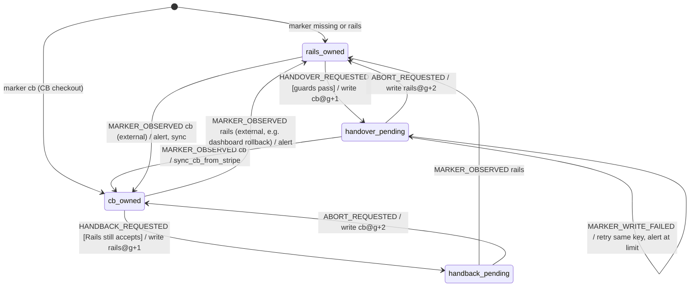

# ADR 0001: One owner per subscription, with an explicit handover marker

- Status: proposed (2026-11-18)
- Lane: `cb-ownership` (Rails-off)
- Code: `apps/web/src/subscriptions/ownership/` (`machine.ts`, `marker.ts`, `access-rule.ts`, `machine.test.ts`)
- Rails source read: `egghead-rails@ae90a443b` (2026-11-16)

## Context

At cutover, Rails (`/stripe_events` and `/webhooks/stripe`) and CourseBuilder (`/api/coursebuilder/webhook/stripe`) will both receive every event from the same Stripe account. Rails handles about 1,400 webhooks a week. Both apps write access, both send email, and both can mutate Stripe. If both act on the same subscription, customers get double emails, conflicting access and, from Rails' reconciler, extra invoices. If neither acts, access drifts.

The Switchboard ruling: "one owner per subscription at any moment, an explicit handover marker, the other side ignores events for subscriptions it doesn't own; state machine first."

Desk picks this ADR builds on:

- CB owns new subscriptions from the flip. Existing subscriptions move in batches, by an explicit marker.
- Canary order: a workshop or other one-time product first, then new subscriptions, then batches of existing ones.
- Rollback: flipping the marker back hands a subscription to Rails. Rails keeps marker-respecting code until it is off.
- Access law (ADR-0006 lenient vs ADR-0008 strict) is a policy input, decided elsewhere.

## Decision

### 1. The marker in Stripe decides who acts

Each Stripe subscription carries two metadata keys:

| Key                        | Values                    | Meaning                                                                                                                  |
| -------------------------- | ------------------------- | ------------------------------------------------------------------------------------------------------------------------ |
| `egghead_owner`            | `cb`, `rails`, or missing | `cb` means CourseBuilder acts. **Anything else means Rails**, including a missing key, an empty string or a typo.        |
| `egghead_owner_generation` | decimal string            | Monotonic write counter. It orders CB's own writes and builds idempotency keys. A missing or malformed value reads as 0. |

Both sides read the same value with the same test, `egghead_owner == "cb"`. So exactly one side acts on every subscription event, whatever state the CB row is in. The tests check this invariant for every state against every marker (`single owner invariant` in `machine.test.ts`).

**Each side reads the marker from the live subscription when it processes the event, never from the event payload.** The payload is a snapshot from when the event was created; after a handover it names the old owner. CB's lifecycle handlers already re-fetch the live subscription (`apps/web/src/inngest/stripe-subscription.ts`, step "load current Stripe subscription"). So does Rails' `CustomerSubscriptionUpdaterWorker` (`app/workers/customer_subscription_updater_worker.rb:15`).

The CB row (`OwnershipRecord`) is CB's intent log and write driver. It never overrides the marker. When the two disagree, CB adopts the marker and alerts.

One-time payments such as workshops, the first canary, have no subscription to hand over. Whoever created the checkout session owns its events for life. CB-created sessions carry `egghead_owner=cb` in session metadata (`oneTimePaymentOwner`).

### 2. States

| State              | Settled owner (acts on events)         | Marker write in flight    |
| ------------------ | -------------------------------------- | ------------------------- |
| `rails_owned`      | Rails                                  | none                      |
| `handover_pending` | **Rails**, until the `cb` marker lands | `cb` at generation g+1    |
| `cb_owned`         | CB                                     | none                      |
| `handback_pending` | **CB**, until the `rails` marker lands | `rails` at generation g+1 |

Ownership changes at one instant: when Stripe stores the new metadata. There is no window in which both sides act or neither does.



### 3. Events

| Event                 | Sent by                                                                      | Payload                                                           |
| --------------------- | ---------------------------------------------------------------------------- | ----------------------------------------------------------------- |
| `HANDOVER_REQUESTED`  | batch runner (operator)                                                      | `batchId`, `at`, `HandoverFacts` gathered from live Stripe and CB |
| `HANDBACK_REQUESTED`  | operator (rollback)                                                          | `batchId`, `at`, `reason`                                         |
| `MARKER_OBSERVED`     | any webhook handler through `decideStripeEvent`, or a readback after a write | live `OwnerMarker`                                                |
| `MARKER_WRITE_FAILED` | the effect runner, when the Stripe metadata update errors                    | `generation`, `error`                                             |
| `ABORT_REQUESTED`     | operator                                                                     | `reason`                                                          |

`transition(record, event, policy)` returns one of three outcomes. `transitioned` means the state changed. `unchanged` means an idempotent no-op or a re-drive. `rejected` comes with every failing reason. `decideStripeEvent(record | null, { liveMarker })` reconciles the row with the live marker, then answers `process` or `ignore`.

The full state × event table is asserted in `state x event matrix`:

|                    | HANDOVER                            | HANDBACK                            | OBSERVED cb           | WRITE_FAILED          | ABORT           |
| ------------------ | ----------------------------------- | ----------------------------------- | --------------------- | --------------------- | --------------- |
| `rails_owned`      | → `handover_pending` if guards pass | no-op                               | → `cb_owned` + alert  | no-op                 | rejected        |
| `handover_pending` | same batch: re-drive; else rejected | rejected                            | → `cb_owned`          | retry; alert at limit | → `rails_owned` |
| `cb_owned`         | no-op                               | → `handback_pending`                | no-op                 | no-op                 | rejected        |
| `handback_pending` | rejected                            | same batch: re-drive; else rejected | no-op (CB still acts) | retry; alert at limit | → `cb_owned`    |

### 4. Handover guards

`handoverRejections(facts, policy, at)` returns every failing guard, so a batch report can show why each subscription stayed behind.

| Guard                                                                               | Rejection                   | Harm it prevents                                                                                                                                                                                                                        |
| ----------------------------------------------------------------------------------- | --------------------------- | --------------------------------------------------------------------------------------------------------------------------------------------------------------------------------------------------------------------------------------- |
| Live marker already `cb`                                                            | `marker_already_cb`         | Re-writing a subscription that has already moved. Send `MARKER_OBSERVED` instead.                                                                                                                                                       |
| `policy.accessReadSide === "cb"`                                                    | `access_read_side_is_rails` | While egghead-next reads access from Rails Postgres, a CB-owned subscription's access would freeze in the Rails DB. Existing subscriptions move only after the read flip.                                                               |
| Status in `policy.handoverStatuses` (suggested: `active`, `trialing`, `canceled`)   | `status_not_eligible`       | Moving a subscription mid-dunning (`past_due`, `unpaid`, `incomplete`, `paused`) would split Stripe retries and dunning email across two systems.                                                                                       |
| `paidThroughAt − at ≥ renewalQuietWindowSeconds` for subscriptions that bill again  | `renewal_window`            | Stripe drafts the renewal invoice about an hour before period end. A move inside the window splits `invoice.created` and `invoice.paid` across owners. Suggested window: 24 hours.                                                      |
| No Stripe event for the subscription within `eventSettleSeconds`                    | `recent_stripe_activity`    | Rails defers work (`perform_in(5.seconds)` at `stripe_events_controller.rb:210`, `perform_in(1.minute)` at `:277`). The settle window lets those jobs drain before the flip. Suggested: 10 minutes.                                     |
| No other non-moving subscription on the same Stripe customer                        | `customer_split`            | Rails resolves records by **customer**, not subscription (`Subscription.find_by_stripe_customer_id`, `Account.find_by(stripe_customer_id:)`). On a split customer, Rails would mutate a CB-owned account. Batches move whole customers. |
| Team: CB holds the seat roster                                                      | `team_seats_not_projected`  | Seat holders would lose access the moment CB starts deciding seats.                                                                                                                                                                     |
| Team: no seat change in flight                                                      | `team_seat_change_pending`  | A quantity change that straddles the flip lands half on each side.                                                                                                                                                                      |
| CB's access law grants exactly what Rails grants today, unless `acceptAccessChange` | `access_would_change`       | A silent change to what a customer was promised, on move day. Under ADR-0008 strict, `trialing` and stale-period subscribers lose access. The rule is injected (`policy.cbAccessRule`), never hard-coded.                               |

Handback has one guard, `policy.railsAcceptsHandback`. Once Rails is off, there is nobody to hand back to (`rails_retired`).

`suggestedOwnershipPolicy({ cbAccessRule, accessReadSide })` fills in the windows and statuses above. It requires the two decisions that aren't made here.

### 5. Who writes the marker

- **CB writes every marker change**, from the effect runner, after the CB row is persisted. There is one writer, serialized per subscription. The CB webhook functions already use an Inngest concurrency key on the subscription id; the batch runner and the handback action must use the same key.
- **CB checkout writes `cb@1` when it creates a subscription.** The marker goes in both the session `metadata` and `subscription_data.metadata`, built with `ownerMarkerMetadata("cb", 1)`. That covers subscription checkout (`apps/web/src/app/pricing/actions.ts:250-264`) and workshop checkout. CB-born subscriptions start `cb_owned`.
- **Rails never writes the marker.**
- **A human may flip it** in the Stripe dashboard as the emergency rollback lever. CB adopts the change and raises `marker_changed_externally`.

Handover order: persist the `handover_pending` row, then call `stripe.subscriptions.update(id, { metadata }, { idempotencyKey })`. The metadata change makes Stripe emit `customer.subscription.updated`, and both apps receive it. Rails sees `cb` and skips. CB sees `cb` at the expected generation, commits to `cb_owned`, and runs `sync_cb_from_stripe`, a full re-read of the live subscription and its seats. So **the marker write is its own confirmation and its own resync.** Handback works the same way in reverse: Rails' `CustomerSubscriptionUpdaterWorker` re-fetches the subscription and rebuilds Rails state from Stripe.

### 6. Idempotency

- Every marker write uses the Stripe idempotency key `egghead-owner:{subscriptionId}:{owner}:{generation}`, and retries reuse it.
- A new generation is always `max(row generation, live marker generation) + 1`, so a later write always outranks an earlier one.
- When the same batch requests the same move again, the machine re-drives the same write: same key, attempt count reset. A different batch gets `transition_in_flight`.
- Requesting a move that already happened is a no-op (`unchanged`).
- `decideStripeEvent` is a pure function of the row and the live marker. A redelivered event gets the same answer and doesn't rewrite the row (`recordChanged: false`).
- Event-level dedupe stays where it is: Inngest `idempotency: event.data.stripeEvent.id` on CB, and `StripeWebhookEvent.already_processed?` on Rails.

### 7. What the non-owner does

The non-owner ignores the event and **acknowledges it with a 2xx.** A 4xx or 5xx makes Stripe retry for up to three days without alerting anyone useful. Each side logs `ownership.skipped` with the event id, event type, subscription id and marker generation, and no customer data.

The non-owner keeps no shadow state for subscriptions it doesn't own. When ownership comes back, the new owner rebuilds from the live Stripe subscription, because every commit triggers a full re-read.

CB gets access for Rails-owned subscriptions through the Rails → PlanetScale access projection (audit lane L7), not through Stripe events.

### 8. Failure cases

| Case                                                                  | What happens                                                                                                                                                                                                                                                                                                                                                                        |
| --------------------------------------------------------------------- | ----------------------------------------------------------------------------------------------------------------------------------------------------------------------------------------------------------------------------------------------------------------------------------------------------------------------------------------------------------------------------------- |
| **Event during handover** (row `handover_pending`, marker not landed) | The live marker says rails, so Rails processes and CB ignores. If the marker has landed by the time CB processes the event, CB commits first and then processes, while Rails sees `cb` and skips. Tested in `events during handover`.                                                                                                                                               |
| **Rails event queued before the flip, run after it**                  | Rails workers re-check the live marker when they run (patch item 4 below). CB's commit-time resync already reflects whatever the event changed.                                                                                                                                                                                                                                     |
| **Marker write fails**                                                | `MARKER_WRITE_FAILED` retries with the same idempotency key, up to `maxMarkerWriteAttempts`. Then it alerts `marker_write_retries_exhausted` and **stays pending**: a timeout is ambiguous, and the write may have landed. Rails keeps acting throughout, so nothing is dropped. Any later observation of `cb` commits. An operator either re-drives with the same batch or aborts. |
| **Abort after an ambiguous write**                                    | The abort writes the settled owner at `pending generation + 1`, which outranks the in-flight write. If the old write still wins somehow, the live marker still names exactly one owner, and CB adopts it with an alert.                                                                                                                                                             |
| **Stripe retries**                                                    | Both sides already dedupe by event id. The ownership answer is deterministic, and ignored events return a 2xx, so retries stop.                                                                                                                                                                                                                                                     |
| **Out-of-order events**                                               | Ownership comes from the live marker at processing time, not from the event's age. Inside CB, the lifecycle's existing `stripeEventCreatedAt` guard stops stale snapshots overwriting newer access (`apps/web/src/subscriptions/access.ts`). The row's generation never decreases.                                                                                                  |
| **Team subscriptions with seats**                                     | Seats move with their subscription. The guards require CB to hold the roster and no seat change to be in flight. While CB owns a team subscription, Rails' seat and invite endpoints for that account must refuse changes (patch item 5).                                                                                                                                           |
| **Marker removed or edited by hand**                                  | A missing or garbled value reads as rails on both sides, so exactly one side still acts. CB adopts the change and alerts, and an unknown value also raises `marker_unrecognized`.                                                                                                                                                                                                   |
| **Rails off**                                                         | Set `railsAcceptsHandback: false`. Handback is refused, and the marker remains the record of who owns each subscription.                                                                                                                                                                                                                                                            |

## XState

The repo has no XState dependency, and this lane's write scope excludes `package.json`. So `machine.ts` is a typed transition function in the shape of XState 6 `setup()`: states are `OwnershipState`, events are `OwnershipEvent`, guards are `handoverRejections`, and actions are `OwnershipEffect`s. Porting it means wrapping it, not redesigning it. The pure form is also easier for the lifecycle lane to call inside an Inngest `step.run`.

## Rails patch (for the desk; this lane does not edit egghead-rails)

Line references are against `egghead-rails@ae90a443b`.

**1. Ownership helper, new file `app/services/egghead_ownership.rb`.**

```ruby
module EggheadOwnership
  OWNER_KEY = 'egghead_owner'.freeze

  module_function

  # Accepts a Stripe::Subscription or a subscription id. Reads the LIVE subscription.
  def cb_owned_subscription?(subscription_or_id)
    return false if subscription_or_id.blank?
    sub = subscription_or_id.is_a?(String) ? StripeService.retrieveSubscription(subscription_or_id) : subscription_or_id
    sub.metadata.to_h.stringify_keys[OWNER_KEY] == 'cb'
  end

  def cb_owned_session?(object)
    object.respond_to?(:metadata) && object.metadata.to_h.stringify_keys[OWNER_KEY] == 'cb'
  end

  # Subscription id carried by an event object, by Stripe type (API 2022-11-15).
  def subscription_id_for(type, object)
    case type
    when /\Acustomer\.subscription\./ then object.id
    when /\Ainvoice\./               then object.subscription
    when /\Acheckout\.session\./     then object.subscription
    when /\Acharge\.dispute\./       then invoice_subscription(StripeService.retrieveCharge(object.charge).invoice)
    when /\Acharge\./                then invoice_subscription(object.invoice)
    end
  end

  def invoice_subscription(invoice_id)
    invoice_id.present? ? StripeService.retrieveInvoice(invoice_id).subscription : nil
  end

  def skip?(type, object)
    cb_owned_session?(object) || cb_owned_subscription?(subscription_id_for(type, object))
  end
end
```

`customer.subscription.*` payloads already carry metadata, but `skip?` deliberately re-fetches by id, because the payload is a snapshot. That adds one Stripe GET per event, about 1,400 a week.

**2. `app/controllers/stripe_events_controller.rb`.** After the `StripeWebhookEvent` row is created (`:29-34`) and before dispatch (`:48`), add:

```ruby
if EggheadOwnership.skip?(@event.stripe_type, @event.event_object)
  log_migration_event('stripe.webhook.ownership_skipped',
    stripe_event_id: params['id'], event_type: params['type'])
  @event.mark_as_processed
  head 200 and return
end
```

The guard must call `mark_as_processed` and return **200**. The existing fall-through returns 400 when an event isn't processed (`:87-97`), and Stripe would keep retrying that for days. Marking the event processed also makes `already_processed?` (`:16`) short-circuit the retries.

Handlers covered:

- `checkout_session_completed` and `async_payment_succeeded` (`:130-171`). These already skip CB checkouts, because CB never sets `metadata[:site]` (`:140`); the marker makes the skip explicit.
- `charge_dispute_funds_withdrawn` (`:186-197`), which calls `account.hard_cancel!`, which cancels in Stripe.
- `customer_subscription_updated` (`:199-211`).
- `charge_succeeded` and `charge_refunded` (`:213-244`).
- `invoice_payment_succeeded` and `invoice_payment_failed` (`:246-336`).
- `customer_subscription_deleted` (`:338-431`), which calls `hard_cancel!` and `review_access_levels!`.
- `customer_subscription_created` (`:446-466`). Today `StripeCreateSubscriptionService` runs for **every** subscription, CB-born ones included.

**3. `/webhooks/stripe`** (StripeEvent engine: `config/routes.rb:20`, `config/initializers/stripe.rb:16-28`). In `Stripe::BaseReceiver#call` (`app/services/stripe/base_receiver.rb:10-25`), before `process_event` (`:25`), add the same check: if `EggheadOwnership.skip?(event_type, event_object)`, mark the webhook event processed, log, and `return true`. Do this whichever endpoint is registered in Stripe; the audit lists both.

**4. Deferred workers re-check when they run.** These guards close the gap for events queued before the flip.

- `Stripe::CustomerSubscriptionUpdater#call` (`app/services/stripe/customer_subscription_updater.rb:20`): `return if EggheadOwnership.cb_owned_subscription?(stripe_subscription)`. One check covers `CustomerSubscriptionUpdaterWorker` (`app/workers/customer_subscription_updater_worker.rb:25`), `StripePostponeCustomerSubscriptionUpdaterWorker` (`:21-28`) and `Stripe::Receivers::CustomerSubscriptionUpdated` (`:27`).
- `StripeInvoicePaymentSucceededWorker#perform` (`app/workers/stripe_invoice_payment_succeeded_worker.rb:16`, after `retrieveInvoice`): `return if EggheadOwnership.cb_owned_subscription?(invoice.subscription)`.
- `RecordRefundTransactionWorker#perform` (`app/workers/record_refund_transaction_worker.rb:14-21`, after the charge loads): skip when the charge's invoice subscription is CB-owned, or the charge metadata says `cb`.
- `StripeReconciler#process_charge` (`app/workers/stripe_reconciler.rb:70-85`) and **`#process_invoice_item` (`:144-152`)**: skip CB-owned subscriptions. `process_invoice_item` **creates and pays Stripe invoices**, which makes it a money mutation and the highest priority on this list.
- `AccountSubscriptionRenewalWorker` (`app/workers/account_subscription_renewal_worker.rb:12-27`): skip CB-owned `stripe_subscription_id`s, so customers don't get a second renewal reminder.

**5. Rails-initiated Stripe mutations refuse CB-owned subscriptions.** Raise, or no-op with a log line; never mutate.

- `Account#hard_cancel!` (`app/models/account.rb:164-172`), before `StripeService.cancelSubscription`. Account deletion (`app/services/delete_user_service.rb:84`) and disputes reach it.
- The `SubscriptionPayments` save path: the quantity update (`app/models/concerns/subscription_payments.rb:87`) and `execute_cancellation` (`:211-222`).
- `StripeEmailUpdateWorker` (`app/workers/stripe_email_update_worker.rb:23-30`): skip customers whose subscriptions are all CB-owned; CB owns their email sync.
- Team seat and invite endpoints (`api/v1/accounts`, `team_members`): return 409 and point to egghead.io for accounts whose subscription is CB-owned. Traffic is low; the desk may prefer a read-only banner.

**6. Rails specs.** Add one spec per entry point. For a CB-marked subscription, each entry point must leave the DB untouched, make no Stripe mutation call, return 200 and mark the event processed. With a missing or `rails` marker, behavior must match today's exactly.

## Open questions, with recommendations

1. **Where the CB row lives.** The machine doesn't care about storage. _Recommendation:_ a small `egghead_subscription_ownership` table keyed by Stripe subscription id (state, generation, pending JSON, `updated_at`), in the lifecycle lane's schema. Don't overload `merchant_subscription` metadata.
2. **Checkout must stamp the marker.** `apps/web/src/app/pricing/actions.ts:250-264` sets `metadata` and `subscription_data.metadata` without the marker, and that file is outside this lane. _Recommendation:_ before CB checkout goes live, its owner spreads `ownerMarkerMetadata("cb", 1)` into both fields, and does the same for workshop sessions. Until then, CB-born subscriptions read as Rails-owned and **CB ignores them.**
3. **Lifecycle seam.** The lifecycle lane's "do I own this subscription?" function should run after "load current Stripe subscription". It calls `decideStripeEvent(row, { liveMarker: readOwnerMarker(liveSubscription.metadata) })`, persists the row when `recordChanged`, and returns early with a 2xx on `ignore`. _Recommendation:_ keep that lane's non-production `true` stub until the row table exists, then swap in this body.
4. **Batch unit.** _Recommendation:_ move whole Stripe customers, not single subscriptions (the `customer_split` guard). Rails' customer-keyed lookups make anything finer unsafe.
5. **Read flip before batches.** Existing subscriptions can't move while egghead.io reads access from Rails, so `access_read_side_is_rails` blocks them. _Recommendation:_ keep that guard. The new-subscription canary also comes after the read flip, because CB checkout only exists there.
6. **Strict vs lenient.** This is still Joel's call (ADR-0006 vs ADR-0008). _Recommendation:_ run the first batches with `cbAccessRule: lenientStatusRule`, so they move with zero access change. Tighten separately, cohort by cohort, as ADR-0006's dial-in note describes.
7. **Settle and renewal windows.** The suggested values (10 minutes and 24 hours) are inferred from Rails' `perform_in` delays and Stripe's roughly one-hour invoice lead. _Recommendation:_ check them against the Axiom event-gap distribution in the commerce proof seam (audit lane L6) before the first batch.
